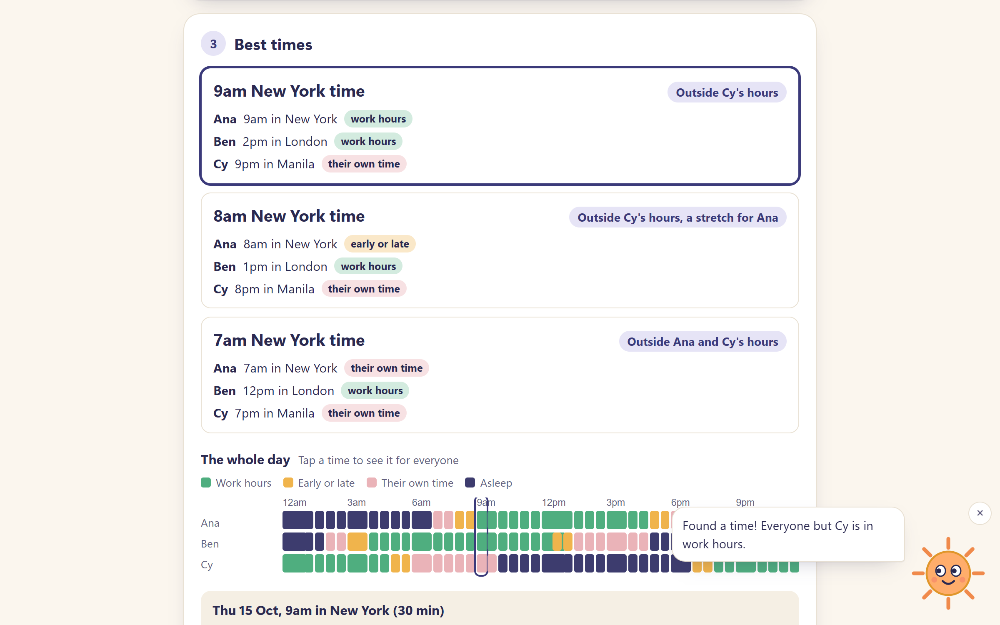

# GoodHours

What time works for everyone? Add where each person is and the hours they work, and GoodHours shows the times that land inside everyone's day, in each person's own time. It warns you when clocks are about to change, suggests taking turns when no time suits everyone, and writes the invite for you.

**Use it:** https://goodhours.johanthegoat.xyz



## Why

Meetings across time zones are moving into the night. Microsoft's 2025 Work Trend Index found meetings after 8pm up 16% in a year, and put much of it down to teams spread across time zones ([Axios](https://www.axios.com/2025/06/17/microsoft-remote-work-meetings), [HR Executive](https://hrexecutive.com/talent-management-in-the-age-of-the-infinite-workday-microsofts-recommendations/)).

The usual tool is a converter with fixed offsets, and that is wrong for part of every year. Countries change their clocks on different dates: in 2026 the UK and EU go back on 25 October and the US on 1 November, so for that week New York is 4 hours behind London, not 5 ([Live Science](https://www.livescience.com/56048-daylight-saving-time-guide.html)). A weekly call fixed in one city moves by an hour for everyone else, and nobody notices until someone misses it.

When there is no good time at all, the fair move is to share the bad one. GitLab's remote handbook asks teams to check everyone's time zone before setting a meeting ([GitLab](https://handbook.gitlab.com/handbook/company/culture/all-remote/meetings/)), and teams there alternate a recurring meeting between two slots so the same region doesn't always take the late one ([Matt Blodgett](https://www.mattblodgett.com/2020/12/)).

## How it works

- **Real time zones.** Every time is worked out with `Intl.DateTimeFormat` and the IANA zone names (`Europe/London`, not "GMT+1"), so each day uses the offset that is actually in force there. Wall-clock times in the hour skipped by a spring-forward land just after the gap, like calendar apps do.
- **How a time feels.** For each person, each start time is checked at its start, middle and last minute against their hours and working days. It's *work hours*, *early or late* (within an hour of their day), *their own time*, or *asleep* (10pm to 7am). A 4:45pm start for 30 minutes runs past 5pm, so it counts as late. Shifts that run past midnight (22:00-06:00) belong to the day they started, and working weeks can be any days (Sunday to Thursday works).
- **Best times.** Every half hour of the day is scored. The list sorts by the unhappiest person first, then the total, so one person at 3am never wins because everyone else is comfy. Neighbouring times with the same score are skipped, so the three picks are three different ideas.
- **Taking turns.** When the best time still leaves someone outside their hours, GoodHours looks at every pair of times and picks the one where the worst-off person's total over two weeks is lowest. It only suggests it if alternating is fairer than one fixed time.
- **Clock change warnings.** For a weekly meeting, it walks the next 8 weeks in the organiser's city and lists the week each person's local time moves, with the before and after. For a one-off, it warns if any city changes its clocks within a week of the day.
- **Typing hours.** `9-5`, `9am-5:30pm`, `08:00-16:00`, `8.30 to 4`, `10pm-6am`. "9-5" with no am or pm means 9am to 5pm.
- **Cities.** 116 cities with their zones, found by name, word start, country, older names (Calcutta, Saigon, Kiev) or zone name, accents ignored.
- **Sharing.** The invite text lists each person's day and time in their own city. The share link carries everyone in the URL fragment.

## Sol

Sol is the sun in the corner. Sol shows how the time you're looking at feels: a bright sun when it's work hours for everyone, an orange evening sun when someone is stretching, and a sleepy moon with stars and a little "z" when it's the middle of the night for someone. Sol's eyes follow your pointer or the box you're typing in, a tap gives a tip for the step you're on, and Sol speaks up when clocks are about to change or nobody's day lines up. Tap five times fast for a spin. The × tucks Sol away. Everything Sol says is read out by screen readers, and Sol keeps still if you've asked for less motion.

## Run it

Open `index.html`. No build step.

```
npm test
```

runs the engine and city tests on Node 20, 22 and 24 (also in CI).

MIT licence.
